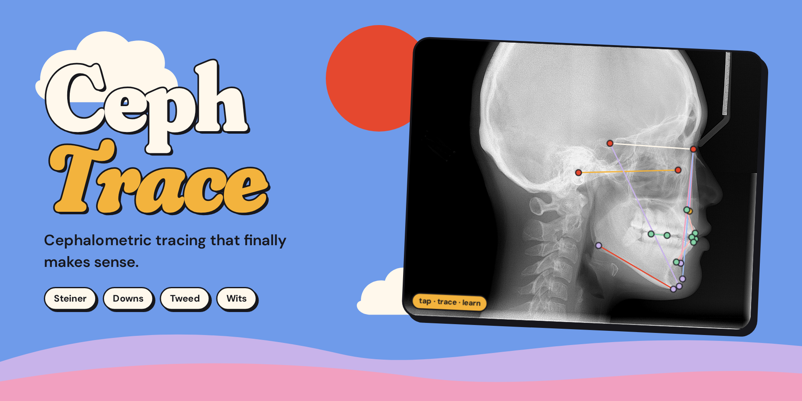
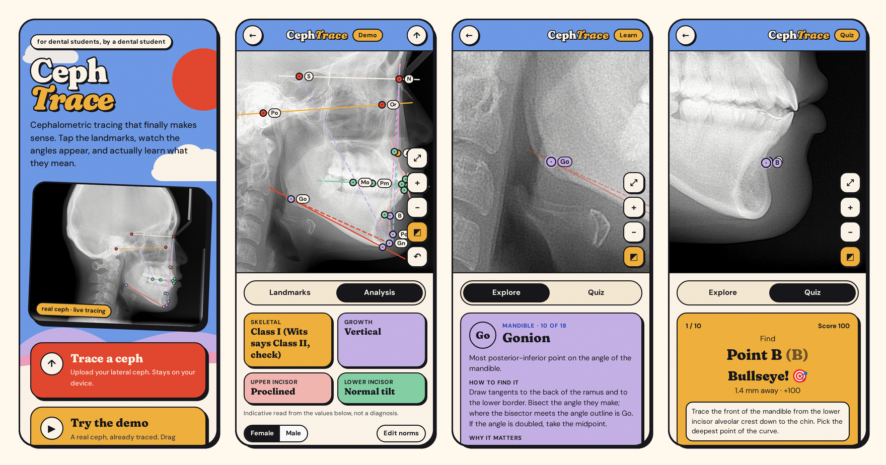
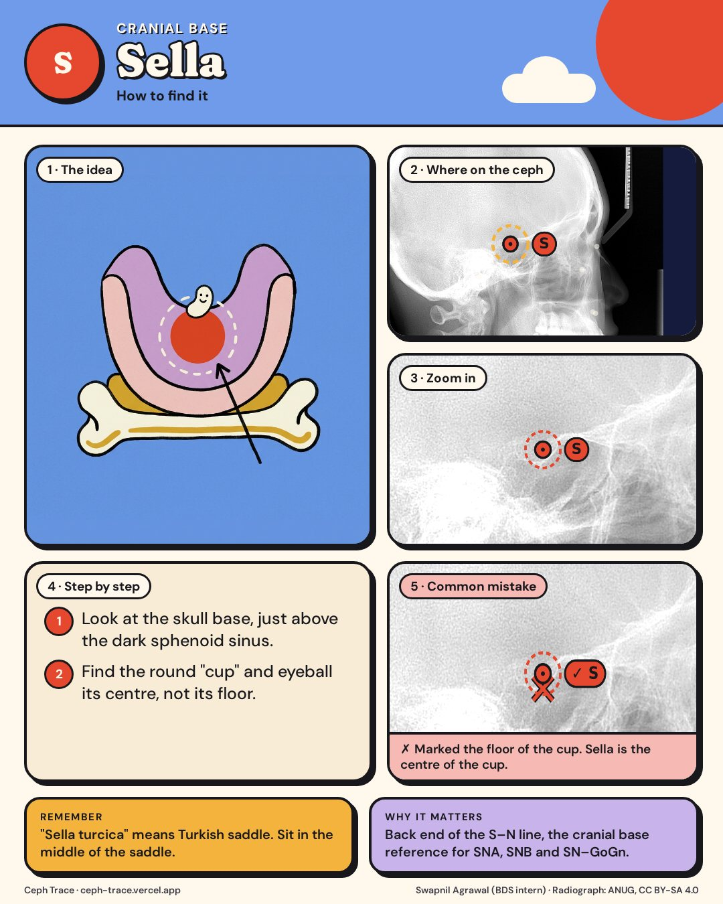
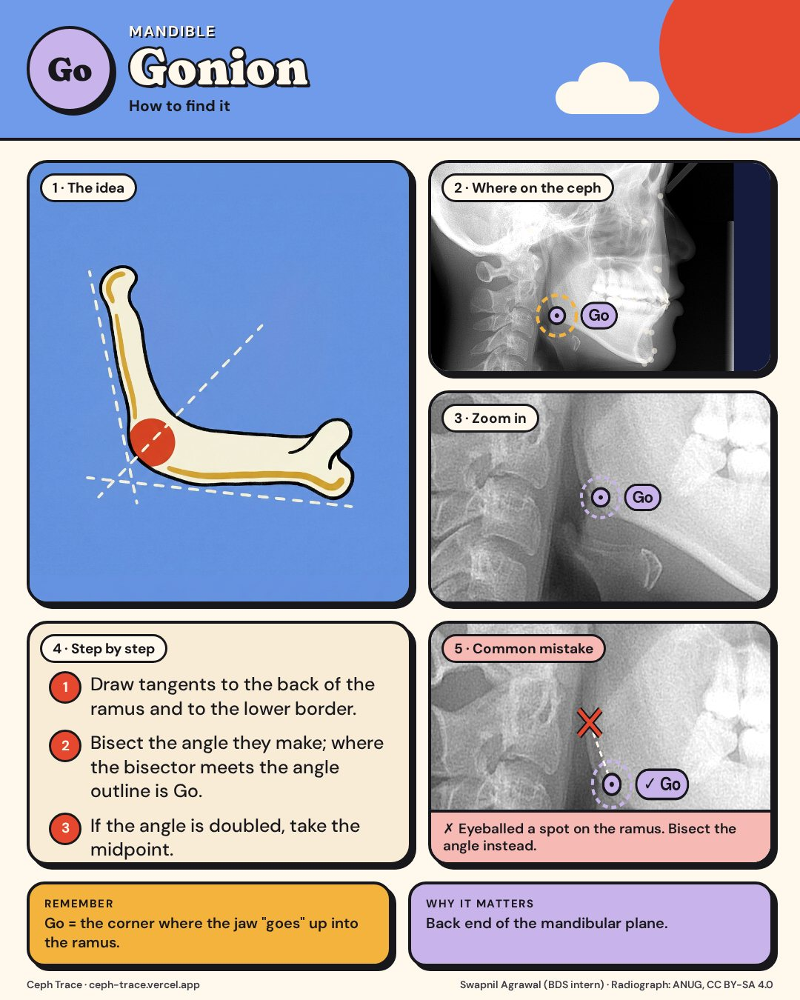
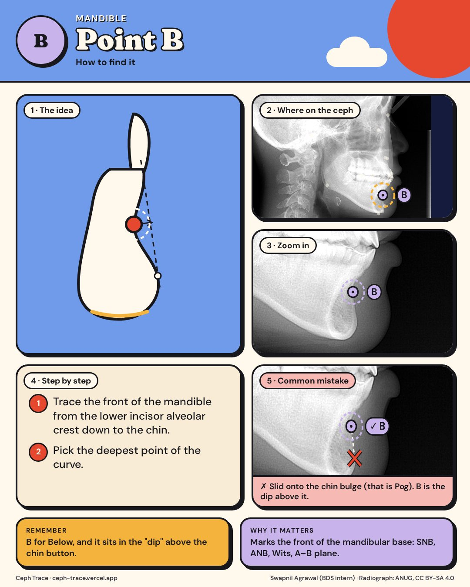

<p align="center">
  
</p>

<h3 align="center">Tap the landmarks. Watch the angles appear. Actually learn what they mean.</h3>

<p align="center">
  <a href="https://ceph-trace.vercel.app/"><b>🚀 Open the app</b></a> ·
  <a href="#-learn-mode-for-students">✦ Learn mode</a> ·
  <a href="#-whats-measured">📐 What's measured</a>
</p>

---

Ortho isn't a boring subject. It just gets taught like one: a 40-page chapter, a blurry photocopied ceph, and 18 landmarks you're supposed to "just know".

**Ceph Trace** turns it into something you can touch. Upload a lateral ceph on your phone, tap each landmark with a magnifying loupe, and Steiner, Downs, Tweed and Wits fill in live. Stuck? Every landmark comes with a plain-English guide and a zoomed view of where it sits on a real radiograph. Then test yourself in a tap-to-find quiz.

<p align="center">
  
</p>

## ✨ What it does

| | |
|---|---|
| ⬆ **Trace your ceph** | Upload a lateral cephalogram. Guided 18-landmark flow with a zoom loupe, pinch zoom, drag-to-refine and undo. |
| 📏 **Calibrate** | Tap two marks on the ruler and enter the distance to get real mm values. |
| 📊 **Live analysis** | 21 measurements across Steiner, Downs, Tweed and Wits, each with a norm range bar and a one-line "what this means". |
| 🧭 **Quick read** | Skeletal class (ANB, cross-checked with Wits), growth pattern, and upper and lower incisor inclination at a glance. |
| ✦ **Learn mode** | Explore every landmark on a real ceph: definition, how to find it, why it matters, and a memory hook. |
| 🖼 **Infographics** | A 5-panel "how to find it" card for all 18 landmarks: a doodle of the idea, where it sits, a zoom, step by step, and the common mistake. Downloadable. |
| 🎯 **Quiz** | 10 random landmarks. Tap where you think each one is. Within 2 mm is a bullseye. |
| 🧾 **Export** | A clean PNG report (traced ceph + all values) and a CSV with values and landmark coordinates. |
| 🔒 **Private** | Everything runs in your browser. The radiograph never leaves your device. |

## ✦ Learn mode (for students)

Most of us don't struggle with the maths. We struggle with *finding the point*. So every landmark comes with:

- **Definition**: the textbook line, kept short
- **How to find it**: what to actually look for on the film
- **Why it matters**: which measurements break if you misplace it
- **Memory hook**: e.g. *"A is Above (maxilla), B is Below (mandible)"*

<p align="center">  </p>

Then the **quiz** hides all the points and asks you to find them. You get your error in mm and a "revise next" list at the end.

## 📐 What's measured

| Analysis | Measurements |
|---|---|
| **Steiner** | SNA · SNB · ANB · SN–GoGn · Occlusal plane–SN · U1–NA (° and mm) · L1–NB (° and mm) · Interincisal angle · U1–SN |
| **Downs** | Facial angle · Angle of convexity · A–B plane · Y-axis · Cant of occlusal plane · U1–APog |
| **Tweed** | FMA · IMPA · FMIA |
| **Wits** | AO–BO on the functional occlusal plane (premolar + molar overlap), female and male norms |

**Landmarks (18):** S · N · Or · Po · A · B · Pog · Gn · Me · Go · U1 tip / apex / labial · L1 tip / apex / labial · premolar occlusion · molar occlusion

Default norms are the commonly quoted Steiner, Downs, Tweed and Jacobson values. Population norms differ, so tap **Edit norms** to set your own (saved on your device).

## 🛠 Run it locally

No build step, no dependencies to install. It's a static site.

```bash
git clone https://github.com/swapagrawal14/ceph-trace.git
cd ceph-trace
python3 -m http.server 8000   # then open http://localhost:8000
```

Deploy anywhere static: Vercel (Framework preset: Other), Netlify, GitHub Pages.

```
index.html     app shell (home + workspace)
style.css      flat gouache design system
sketch.js      p5.js canvas: tracing, loupe, explore, quiz, export
analysis.js    landmarks, learning content, measurements, norms
demo.js        demo ceph landmarks + ruler calibration
assets/        demo ceph, fonts, banner, screenshots, doodles, infographics
tools/         infographic.html (renders the 18 infographic cards)
lib/p5.min.js  p5.js 1.9.4 (bundled, works offline)
```

## ⚠️ Disclaimer

Ceph Trace is an **educational aid** for tracing practice. It is not a diagnostic device. Verify every landmark and value clinically and with your guide or faculty. The demo tracing is a reference for practice, not a gold standard.

## 🙏 Credits

- Demo radiograph: [*Cephalometric radiograph*](https://commons.wikimedia.org/wiki/File:Cephalometric_radiograph.JPG) by ANUG, Wikimedia Commons, [CC BY-SA 4.0](https://creativecommons.org/licenses/by-sa/4.0/) (resized)
- Built with [p5.js](https://p5js.org/) · Type: Fraunces & DM Sans

<p align="center"><br><b>Made by Swapnil Agrawal (BDS intern)</b><br>because ortho deserved better than boring.</p>
